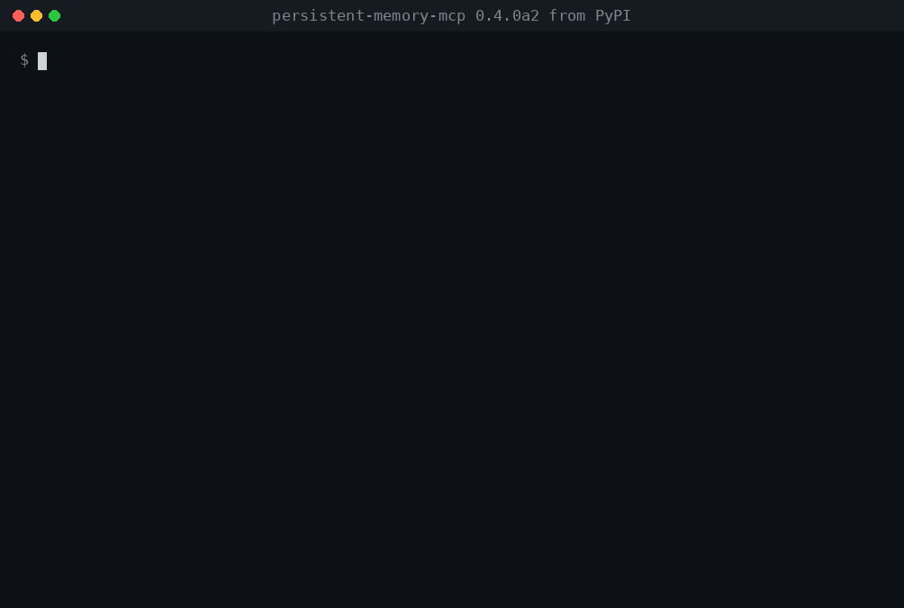

# persistent-memory

[](https://pypi.org/project/persistent-memory-mcp/) [](https://pypi.org/project/persistent-memory-mcp/) [](https://github.com/Musyg/persistent-memory/actions/workflows/test.yml) [](https://github.com/Musyg/persistent-memory/blob/main/LICENSE)

Les agents IA s'appuient sur ce qu'ils ont retenu, quelle que soit leur structure : un assistant de code, un graphe LangGraph ou CrewAI, une application OpenAI Agents SDK, votre propre boucle. Ils retiennent des faits, des résumés, des procédures et des leçons tirées de tâches précédentes. Quand une source est corrigée ou retirée, ce qui en a été tiré continue d'être servi, et personne ne prévient l'agent. persistent-memory enregistre les versions exactes des sources de chaque élément dérivé, refuse de servir ce qui dépend d'une version retirée ou remplacée, et prévient chaque client à qui elle a été montrée.

Bibliothèque standard Python uniquement (SQLite avec FTS5), Python 3.11 ou plus récent, Linux, macOS et Windows. C'est une version alpha, 0.4.0a3 : les interfaces peuvent encore changer. Le module s'importe sous le nom `persistent_memory`.



Une vraie session, depuis une installation neuve à partir de PyPI ; seule la frappe est scriptée. [Ce qu'elle montre et comment elle a été enregistrée](https://github.com/Musyg/persistent-memory/blob/main/docs/demo/README.md).

[English](https://github.com/Musyg/persistent-memory/blob/main/README.md) · [Brancher vos outils](https://github.com/Musyg/persistent-memory/blob/main/docs/SETUP.fr.md) · [Opérations](https://github.com/Musyg/persistent-memory/blob/main/docs/OPERATIONS.fr.md) · [Serveur MCP](https://github.com/Musyg/persistent-memory/blob/main/docs/MCP.fr.md) · [Résultats mesurés](https://github.com/Musyg/persistent-memory/blob/main/docs/EVIDENCE.fr.md) · [Paquets et versions](https://github.com/Musyg/persistent-memory/blob/main/PACKAGES.fr.md)

## Installer et brancher

```sh
python3 -m venv ~/.persistent-memory
~/.persistent-memory/bin/pip install persistent-memory-mcp
~/.persistent-memory/bin/persistent-memory setup claude-code
```

Sur PyPI, le paquet s'appelle `persistent-memory-mcp` ; les commandes et le nom d'import restent `persistent-memory` et `persistent_memory`. Tant que seules des pré-versions sont publiées, pip choisit la plus récente sans `--pre`. Sous Windows, les commandes se trouvent dans `.persistent-memory\Scripts\`.

`setup` accepte `claude-code`, `claude-desktop`, `cursor`, `vscode` (GitHub Copilot), `windsurf`, `codex` et `hermes-agent` (Hermes Agent de Nous Research). Tous les outils branchés ouvrent la même mémoire, dans le dossier de données du système : ce qui est retenu dans l'un se retrouve dans les autres, et un retrait fait dans l'un est signalé à chaque outil qui avait vu l'entrée.

`setup` conserve les autres entrées de chaque fichier de configuration, en garde une copie avant de le modifier, ne remplace pas sans `--force` une entrée du même nom qui lance un autre serveur, ne touche pas un fichier qu'il ne sait pas lire, et ne change rien si on le relance. `--dry-run` montre d'abord la modification ; `persistent-memory status` liste ce qui est configuré. [SETUP.fr.md](https://github.com/Musyg/persistent-memory/blob/main/docs/SETUP.fr.md) indique le fichier écrit pour chaque outil.

## N'importe quel framework d'agents

La mémoire ne dépend d'aucun framework. En Python, utilisez directement la bibliothèque. Tout le reste passe par le serveur MCP, en stdio ou en HTTP, depuis n'importe quel langage. Le 15 novembre 2026, chacun de ces frameworks a chargé les dix outils par sa propre intégration MCP puis a mémorisé, cherché, retiré et cherché à nouveau, l'entrée retirée n'étant plus renvoyée : LangChain / LangGraph, OpenAI Agents SDK, Pydantic AI, CrewAI, LlamaIndex, Microsoft AutoGen, smolagents et le SDK MCP officiel pour Python. Aucun modèle n'a été appelé pendant ces contrôles.

```python
from agents import Agent                      # OpenAI Agents SDK
from agents.mcp import MCPServerStdio

memory = MCPServerStdio(params={"command": "persistent-memory-mcp", "args": ["--create"]})
agent = Agent(name="assistant", instructions="...", mcp_servers=[memory])
```

[FRAMEWORKS.fr.md](https://github.com/Musyg/persistent-memory/blob/main/docs/FRAMEWORKS.fr.md) donne les versions vérifiées et un extrait pour chaque framework.

## Exemple

On retient une source, on en tire une règle, on montre les deux à une session, puis on retire la source :

```python
from persistent_memory import PersistentMemory

memory = PersistentMemory("demo-store", "team-notes", create=True)
port = memory.remember("The test server listens on port 9300.", source_id="port")
rule = memory.derive("Open port 9300 on the test firewall.",
                     parents=[port["ref"]], artifact_id="open-port")
parent = memory.explain("open-port")["parents"][0]["ref"]
print(parent == port["ref"])                    # la version exacte du parent est enregistrée

found = memory.search("firewall 9300", session="chat-1")["items"]
print([item["artifact_id"] for item in found])  # chat-1 voit les deux entrées

memory.withdraw("port", "the port changed")     # on ne retire que la source
refused = memory.read(rule["ref"])
print(refused["allowed"], refused["reason"])    # la règle dérivée est refusée aussi
print(memory.search("firewall 9300")["items"])  # et n'est plus trouvée
print([(n["artifact_id"], n["state"]) for n in memory.notices("chat-1")["notices"]])
print(memory.notices("chat-1")["notices"])      # chaque notice n'est remise qu'une fois
```

Sortie obtenue avec le wheel installé, sous Python 3.13 :

```text
True
['open-port', 'port']
False source_revoked
[]
[('open-port', 'withdrawn'), ('port', 'withdrawn')]
[]
```

Si l'on corrige la source au lieu de la retirer, avec `memory.correct("port", nouveau_texte, expected_version=...)`, la règle est refusée avec `version_not_current` (état `superseded`) et les mêmes notices partent. Une correction fondée sur une version qui n'est plus la version courante est refusée avec `version_conflict`.

Par MCP, ces opérations sont les outils `memory_remember`, `memory_derive`, `memory_search`, `memory_withdraw`, `memory_notices` et cinq autres ; une notice arrive avec le résultat de l'outil suivant.

## Fonctionnement

- **L'autorité à part du contenu.** Une base d'autorité tient les versions, les dépendances et les retraits ; un témoin de fraîcheur est conservé à côté ; le contenu a sa propre base. Chaque lecture est contrôlée par l'autorité courante. Voir [OPERATIONS.fr.md](https://github.com/Musyg/persistent-memory/blob/main/docs/OPERATIONS.fr.md).
- **Des versions exactes.** Une référence réunit un espace, une identité d'objet stable et une version immuable. Un élément dérivé (résumé, procédure, leçon, entrée d'index) nomme les versions exactes de ses parents. Une correction est un compare-and-swap sur la version attendue.
- **La cascade.** Retirer ou corriger une source rend illisible tout ce qui en dérive par `derives` ou `indexes` ; `cites` garde un lien sans propager. `plan_withdrawal` liste d'avance ce qui serait bloqué. Rien n'est effacé physiquement.
- **Les leçons sont des dérivés.** `learn(trace, feedback, lesson)` enregistre la trace d'une tâche et son retour comme sources, puis en dérive la leçon. Seule la leçon est cherchable, et retirer la trace ou le retour la bloque.
- **Des projections jetables.** L'index de recherche et la [projection Qdrant](https://github.com/Musyg/persistent-memory/blob/main/docs/QDRANT.fr.md) facultative peuvent être supprimés et reconstruits. Elles ne font que proposer des candidats ; chacun est relu par l'autorité, si bien qu'un vecteur périmé ne peut pas faire revenir une entrée retirée. Qdrant ne contient jamais le contenu.
- **Les notices.** Un registre note les versions montrées à chaque session (un processus serveur MCP, une session MCP en HTTP, une session Hermes Agent). Quand l'une d'elles n'est plus valide, la session est prévenue une fois.
- **Une vieille sauvegarde ne ressuscite rien.** Une copie de contenu restaurée démarre en quarantaine et se réconcilie avec l'autorité courante ; les sources retirées et ce qui en dépend restent illisibles. Voir le [contrat de reprise](https://github.com/Musyg/persistent-memory/blob/main/docs/RECOVERY.fr.md), ou lancer `hermes-memory-demo --directory NOUVEAU_DOSSIER`.

## Points d'entrée

| Accès | Point d'entrée | Documentation |
| --- | --- | --- |
| Bibliothèque Python | `persistent_memory.PersistentMemory` | [OPERATIONS.fr.md](https://github.com/Musyg/persistent-memory/blob/main/docs/OPERATIONS.fr.md) |
| MCP en stdio | `persistent-memory-mcp --store DOSSIER`, écrit pour vous par `setup` | [MCP.fr.md](https://github.com/Musyg/persistent-memory/blob/main/docs/MCP.fr.md) |
| MCP en Streamable HTTP | `persistent-memory-mcp --transport http` (`/mcp`, fichier de jeton obligatoire hors boucle locale) | [MCP.fr.md](https://github.com/Musyg/persistent-memory/blob/main/docs/MCP.fr.md) |
| Fournisseur de mémoire Hermes Agent | `persistent-memory setup hermes-agent`, depuis l'environnement de Hermes Agent | [HERMES-AGENT.fr.md](https://github.com/Musyg/persistent-memory/blob/main/docs/HERMES-AGENT.fr.md) |
| Projection Qdrant | `--qdrant-url`, `--embed-url`, `--embed-model`, ou `attach_projection` | [QDRANT.fr.md](https://github.com/Musyg/persistent-memory/blob/main/docs/QDRANT.fr.md) |
| Noyau typé, CLI et service HTTP | `hermes-memory`, `hermes-memory-typed` | [API.fr.md](https://github.com/Musyg/persistent-memory/blob/main/docs/API.fr.md) |
| Rendu structuré et admission | `hermes_memory.admission_demo` | [STRUCTURED.fr.md](https://github.com/Musyg/persistent-memory/blob/main/docs/STRUCTURED.fr.md), [ADMISSION.fr.md](https://github.com/Musyg/persistent-memory/blob/main/docs/ADMISSION.fr.md) |

Les cinq premiers passent par la même classe `PersistentMemory` : ils exposent la même mémoire et les mêmes refus. Les interfaces typées utilisent le même noyau et la même autorité.

## Résultats mesurés

Le dépôt publie ses études avec leur protocole, leurs observations et un recalcul hors réseau. Toutes portent sur des scénarios synthétiques et sont reproductibles ; chaque compte ne vaut que dans le périmètre de son étude.

- [Comparatif du cycle de vie](https://github.com/Musyg/persistent-memory/blob/main/benchmarks/lifecycle-20261022/README.fr.md) : sur 100 trajectoires figées, cette mémoire et une référence SQLite qui conserve son autorité servent toutes deux les 751 lectures valides et bloquent les 389 lectures interdites ; restaurer l'ancienne autorité avec l'ancien contenu expose 82 contenus retirés ou remplacés. C'est une égalité sur ces garanties, pas une supériorité.
- [Étude de confirmation](https://github.com/Musyg/persistent-memory/blob/main/benchmarks/validation-20261022/README.fr.md) : sur 100 scénarios répétés trois fois, GPT-6 Luna réussit 298 réponses sur 300 avec mémoire et 29 sur 300 sans. La recherche lexicale atteint 294 sur 300 : aucune supériorité sur elle n'est établie. Deux juges IA, sans audit humain.
- [Apprentissage entre missions](https://github.com/Musyg/persistent-memory/blob/main/benchmarks/action-20261023/experience/README.fr.md) : Luna réussit 22 nouvelles missions sur 24 avec une leçon dérivée, 13 avec la trace complète et 7 sans expérience ; une fois la leçon retirée, 7 sur 24.
- [Pilote sur huit historiques](https://github.com/Musyg/persistent-memory/blob/main/benchmarks/answer-quality-20261029/README.fr.md) : avec des preuves qui évoluent entre les sessions, 77 réussites primaires sur 96, contre 29 sur 96 pour une recherche lexicale versionnée.
- [Comparatif avec ECC Continuous Learning](https://github.com/Musyg/persistent-memory/blob/main/docs/evidence/agentic-transfer-20261104/README.fr.md) : les 128 résultats de 32 cas sont publiés ; les critères fixés d'avance pour conclure à un avantage ne sont pas atteints.

Les autres études, les mesures de performance et les reçus de tests sont dans [EVIDENCE.fr.md](https://github.com/Musyg/persistent-memory/blob/main/docs/EVIDENCE.fr.md) ; la sélection des tests et la façon de relancer la suite depuis un wheel installé sont dans [TESTING.fr.md](https://github.com/Musyg/persistent-memory/blob/main/docs/TESTING.fr.md).

## Plateformes et limites

- **Alpha.** Noms, options et formats de fichiers peuvent changer avant une version stable.
- **Plateformes.** La CI installe le wheel et lance les tests sous Linux, macOS et Windows, de Python 3.11 à 3.14. Sous Windows, gardez la mémoire sur un disque local ; un chemin réseau n'est pas pris en charge.
- **Fichier de jeton sous Windows.** Hors boucle locale, le serveur HTTP exige `--token-file`. Sous Linux et macOS, ce fichier ne doit être lisible que par son propriétaire ; Windows n'a pas ces bits de mode et la liste d'accès du fichier n'est pas inspectée : gardez-le dans votre propre dossier de profil.
- **Un seul processus par mémoire est le cas testé.** SQLite sérialise plusieurs processus, mais ce cas ne fait pas partie des tests de la surface d'opérations.
- **Recherche.** Lexicale par défaut (FTS5 et alias exacts) ; le rappel sémantique demande la projection Qdrant et un service d'embeddings. L'index couvre jusqu'à 5 000 entrées courantes par espace.
- **Admission explicite.** Rien n'est enregistré sans un appel à remember, derive, correct ou learn ; les conversations ne sont pas enregistrées d'elles-mêmes.
- **Le retrait est logique.** Il bloque les lectures futures par cette bibliothèque. Il n'efface pas les octets, ne rappelle pas un texte déjà montré ou copié ailleurs, et ne détecte pas un retour arrière simultané du contenu, de l'autorité et du témoin.
- **Clients vérifiés.** Claude Code, Codex CLI et Hermes Agent ont lu la configuration écrite par `setup` ; Claude Code et Hermes Agent y ont aussi enregistré et retrouvé des entrées pendant des tours de modèle. Les fichiers de Claude Desktop, Cursor, VS Code et Windsurf suivent la documentation de chaque outil et sont vérifiés par des tests, sans avoir été ouverts dans ces applications.
- **Frontière de confiance.** Le serveur HTTP typé combiné expose aussi le RPC privilégié du noyau `/rpc` sous le même jeton. Il convient à une application de confiance, pas à un service multiutilisateur.

## Licence et projet

Licence MIT, par Gilles Musy ([Musyg](https://github.com/Musyg)). [PACKAGES.fr.md](https://github.com/Musyg/persistent-memory/blob/main/PACKAGES.fr.md) retrace l'historique des versions et présente le registre de politiques facultatif, distribué séparément. Le paquet d'implémentation s'appelle `hermes_memory`, le nom historique du projet ; il reste importable. [Contribuer](https://github.com/Musyg/persistent-memory/blob/main/CONTRIBUTING.fr.md) · [English version](https://github.com/Musyg/persistent-memory/blob/main/README.md) · [Sources](https://github.com/Musyg/persistent-memory)
