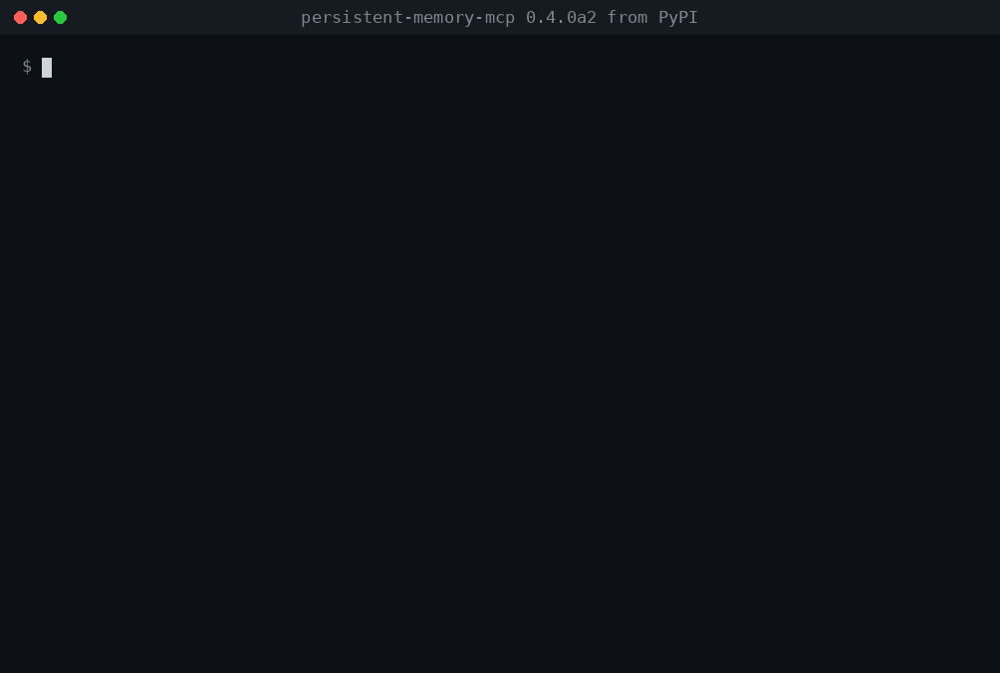

# persistent-memory

<!-- mcp-name: io.github.Musyg/persistent-memory -->

[](https://pypi.org/project/persistent-memory-mcp/) [](https://pypi.org/project/persistent-memory-mcp/) [](https://github.com/Musyg/persistent-memory/actions/workflows/test.yml) [](https://github.com/Musyg/persistent-memory/blob/main/LICENSE)

AI agents act on what they remember, whatever they are built with: a coding assistant, a LangGraph or CrewAI graph, an OpenAI Agents SDK app, your own loop. They remember facts, summaries, procedures and lessons from earlier tasks. When a source is corrected or withdrawn, whatever was built from it keeps being served, and nothing tells the agent. persistent-memory records the exact source versions behind every derived item, refuses to serve anything that depends on a withdrawn or replaced version, and notifies each client that was shown it.

Python standard library only (SQLite with FTS5), Python 3.11 or later, Linux, macOS and Windows. This is an alpha release, 0.4.0a3: interfaces can still change. Import it as `persistent_memory`.



A real session from a fresh install from PyPI; only the typing is scripted. [What it shows and how it was recorded](https://github.com/Musyg/persistent-memory/blob/main/docs/demo/README.md).

[Français](https://github.com/Musyg/persistent-memory/blob/main/README.fr.md) · [Connect your tools](https://github.com/Musyg/persistent-memory/blob/main/docs/SETUP.md) · [Operations](https://github.com/Musyg/persistent-memory/blob/main/docs/OPERATIONS.md) · [MCP server](https://github.com/Musyg/persistent-memory/blob/main/docs/MCP.md) · [Evidence](https://github.com/Musyg/persistent-memory/blob/main/docs/EVIDENCE.md) · [Packages and releases](https://github.com/Musyg/persistent-memory/blob/main/PACKAGES.md)

## Install and connect

```sh
python3 -m venv ~/.persistent-memory
~/.persistent-memory/bin/pip install persistent-memory-mcp
~/.persistent-memory/bin/persistent-memory setup claude-code
```

The package on PyPI is named `persistent-memory-mcp`; the commands and the import name stay `persistent-memory` and `persistent_memory`. While only pre-releases exist, pip selects the newest one without `--pre`. On Windows the commands are in `.persistent-memory\Scripts\`.

`setup` accepts `claude-code`, `claude-desktop`, `cursor`, `vscode` (GitHub Copilot), `windsurf`, `codex` and `hermes-agent` (Nous Research's Hermes Agent). Every tool you connect opens the same store in the platform's data folder: something remembered in one is found in the others, and a withdrawal made in one is reported to every tool that was shown the entry.

`setup` keeps the other entries of each configuration file, saves a backup before changing it, does not replace an entry of the same name that runs another server unless given `--force`, leaves a file it cannot parse untouched, and changes nothing when run twice. `--dry-run` shows the change first; `persistent-memory status` lists what is configured. [SETUP.md](https://github.com/Musyg/persistent-memory/blob/main/docs/SETUP.md) gives the file written for each tool.

## Any agent framework

The memory does not depend on a framework. In Python, use the library directly. Everything else goes through the MCP server, over stdio or Streamable HTTP, from any language. On 15 November 2026 each of these frameworks loaded the ten tools through its own MCP integration and ran remember, search, withdraw and search again, with the withdrawn entry gone: LangChain / LangGraph, OpenAI Agents SDK, Pydantic AI, CrewAI, LlamaIndex, Microsoft AutoGen, smolagents and the official MCP Python SDK. No model was called in these checks.

```python
from agents import Agent                      # OpenAI Agents SDK
from agents.mcp import MCPServerStdio

memory = MCPServerStdio(params={"command": "persistent-memory-mcp", "args": ["--create"]})
agent = Agent(name="assistant", instructions="...", mcp_servers=[memory])
```

[FRAMEWORKS.md](https://github.com/Musyg/persistent-memory/blob/main/docs/FRAMEWORKS.md) gives the versions checked and a snippet for each framework.

## Example

Remember a source, derive a rule from it, show both to a session, then withdraw the source:

```python
from persistent_memory import PersistentMemory

memory = PersistentMemory("demo-store", "team-notes", create=True)
port = memory.remember("The test server listens on port 9300.", source_id="port")
rule = memory.derive("Open port 9300 on the test firewall.",
                     parents=[port["ref"]], artifact_id="open-port")
parent = memory.explain("open-port")["parents"][0]["ref"]
print(parent == port["ref"])                    # the exact parent version is recorded

found = memory.search("firewall 9300", session="chat-1")["items"]
print([item["artifact_id"] for item in found])  # chat-1 is shown both entries

memory.withdraw("port", "the port changed")     # withdraw the source only
refused = memory.read(rule["ref"])
print(refused["allowed"], refused["reason"])    # the derived rule is refused too
print(memory.search("firewall 9300")["items"])  # and no longer found
print([(n["artifact_id"], n["state"]) for n in memory.notices("chat-1")["notices"]])
print(memory.notices("chat-1")["notices"])      # each notice is delivered once
```

Output, from the installed wheel on Python 3.13:

```text
True
['open-port', 'port']
False source_revoked
[]
[('open-port', 'withdrawn'), ('port', 'withdrawn')]
[]
```

Correcting the source instead, with `memory.correct("port", new_text, expected_version=...)`, refuses the rule with `version_not_current` (state `superseded`) and sends the same notices. A correction made against a version that is no longer current is refused with `version_conflict`.

Through MCP the same operations are the tools `memory_remember`, `memory_derive`, `memory_search`, `memory_withdraw`, `memory_notices` and five others; a notice arrives with the next tool result.

## How it works

- **Authority apart from content.** An authority database holds versions, dependencies and withdrawals; a freshness witness is kept beside it; content lives in its own database. Every read is checked against the current authority. See [OPERATIONS.md](https://github.com/Musyg/persistent-memory/blob/main/docs/OPERATIONS.md).
- **Exact versions.** A ref is a workspace, a stable artifact identity and an immutable version. A derived item (summary, procedure, lesson, index entry) names the exact parent versions it was made from. Corrections are compare-and-swap on the expected version.
- **Cascade.** Withdrawing or correcting a source makes everything derived from it through `derives` or `indexes` unreadable; `cites` keeps a link without propagating. `plan_withdrawal` lists what would be blocked. Nothing is physically erased.
- **Lessons are derived items.** `learn(trace, feedback, lesson)` stores a task trace and its feedback as sources and derives the lesson from both. Only the lesson is searchable, and withdrawing the trace or the feedback blocks it.
- **Disposable projections.** The search index and the optional vector projections, [local](https://github.com/Musyg/persistent-memory/blob/main/docs/SEMANTIC.md) or [Qdrant](https://github.com/Musyg/persistent-memory/blob/main/docs/QDRANT.md), can be deleted and rebuilt. They only propose candidates; each one is read again through the authority, so a stale vector cannot bring back a withdrawn entry. Vectors never hold content.
- **Notices.** A ledger records which versions each session was shown (an MCP server process, an HTTP MCP session, a Hermes Agent session). When one of them stops being valid, that session is told once.
- **Old backups stay withdrawn.** A restored content snapshot starts in quarantine and is reconciled with the current authority; withdrawn sources and what depends on them stay unreadable. See the [recovery contract](https://github.com/Musyg/persistent-memory/blob/main/docs/RECOVERY.md), or run `hermes-memory-demo --directory NEW_DIR`.

## Ways in

| Door | Entry point | Documentation |
| --- | --- | --- |
| Python library | `persistent_memory.PersistentMemory` | [OPERATIONS.md](https://github.com/Musyg/persistent-memory/blob/main/docs/OPERATIONS.md) |
| MCP over stdio | `persistent-memory-mcp --store DIR`, written for you by `setup` | [MCP.md](https://github.com/Musyg/persistent-memory/blob/main/docs/MCP.md) |
| MCP over Streamable HTTP | `persistent-memory-mcp --transport http` (`/mcp`, token file required off loopback) | [MCP.md](https://github.com/Musyg/persistent-memory/blob/main/docs/MCP.md#http-transport) |
| Hermes Agent memory provider | `persistent-memory setup hermes-agent`, from Hermes Agent's environment | [HERMES-AGENT.md](https://github.com/Musyg/persistent-memory/blob/main/docs/HERMES-AGENT.md) |
| Search by meaning, local | `--semantic`, extra `[semantic]` or an embeddings endpoint | [SEMANTIC.md](https://github.com/Musyg/persistent-memory/blob/main/docs/SEMANTIC.md) |
| Qdrant projection | `--qdrant-url`, `--embed-url`, `--embed-model`, or `attach_projection` | [QDRANT.md](https://github.com/Musyg/persistent-memory/blob/main/docs/QDRANT.md) |
| Typed core, CLI and HTTP service | `hermes-memory`, `hermes-memory-typed` | [API.md](https://github.com/Musyg/persistent-memory/blob/main/docs/API.md) |
| Structured rendering and admission | `hermes_memory.admission_demo` | [STRUCTURED.md](https://github.com/Musyg/persistent-memory/blob/main/docs/STRUCTURED.md), [ADMISSION.md](https://github.com/Musyg/persistent-memory/blob/main/docs/ADMISSION.md) |

The first five go through the same `PersistentMemory` class, so they expose the same memory and the same refusals. The typed interfaces use the same core and authority.

## Evidence

The repository publishes its studies with protocols, observations and offline recalculation. All of them use synthetic scenarios and can be reproduced; each count holds only within its study's scope.

- [Lifecycle comparison](https://github.com/Musyg/persistent-memory/blob/main/benchmarks/lifecycle-20261022/README.md): on 100 fixed trajectories, this memory and an SQLite reference with retained authority both served all 751 valid reads and blocked all 389 forbidden ones; restoring old authority with old content exposed 82 withdrawn or superseded records. A tie on these guarantees, not a superiority claim.
- [Confirmation study](https://github.com/Musyg/persistent-memory/blob/main/benchmarks/validation-20261022/README.md): on 100 scenarios, three repetitions each, GPT-6 Luna succeeded on 298/300 answers with memory and 29/300 without. Lexical retrieval reached 294/300, so superiority over it is not established. Two AI judges, no human audit.
- [Learned-experience study](https://github.com/Musyg/persistent-memory/blob/main/benchmarks/action-20261023/experience/README.md): Luna succeeded on 22/24 new tasks with a derived lesson, 13/24 with the complete trace and 7/24 without experience; with the lesson withdrawn, 7/24.
- [Answer-quality pilot](https://github.com/Musyg/persistent-memory/blob/main/benchmarks/answer-quality-20261029/README.md): across eight histories whose evidence changes between sessions, 77/96 primary successes against 29/96 for versioned lexical retrieval.
- [Comparison with ECC Continuous Learning](https://github.com/Musyg/persistent-memory/blob/main/docs/evidence/agentic-transfer-20261104/README.md): all 128 outcomes from 32 cases are published; the predefined advantage criteria were not met.

The other studies, performance measurements and test receipts are in [EVIDENCE.md](https://github.com/Musyg/persistent-memory/blob/main/docs/EVIDENCE.md); test selection and how to rerun the suite from an installed wheel are in [TESTING.md](https://github.com/Musyg/persistent-memory/blob/main/docs/TESTING.md).

## Platforms and limits

- **Alpha.** Names, options and file formats can change before a stable release.
- **Platforms.** CI installs the wheel and runs the tests on Linux, macOS and Windows, Python 3.11 to 3.15. On Windows, keep the store on a local disk; a network path is not supported.
- **Token file on Windows.** Off loopback the HTTP server requires `--token-file`. On Linux and macOS that file must be readable by its owner only; Windows has no such mode bits and the file's access list is not inspected, so keep it in your own profile folder.
- **One process per store is the tested case.** Several processes are serialized by SQLite but are not part of the operations surface's tests.
- **Search.** Lexical (FTS5 plus exact aliases) by default. Search by meaning is optional: `--semantic` runs a model in the process (`pip install "persistent-memory-mcp[semantic]"`, about 1 GB downloaded on first start), or the Qdrant projection uses a server. The index covers up to 5,000 current entries per workspace.
- **Explicit admission.** Nothing is stored unless a client calls remember, derive, correct or learn; conversations are not recorded by themselves.
- **Withdrawal is logical.** It blocks future reads through this library. It does not erase bytes or recall text already shown or copied elsewhere, and it cannot detect a coordinated rollback of content, authority and witness together.
- **Client coverage.** Claude Code, Codex CLI and Hermes Agent read the configuration that `setup` wrote; Claude Code and Hermes Agent also stored and found entries through it in model turns. The Claude Desktop, Cursor, VS Code and Windsurf files follow each tool's documentation and are checked by tests, not opened in those applications.
- **Trust boundary.** The combined typed HTTP server also exposes the privileged core `/rpc` under the same token. It is meant for a trusted application, not a multi-tenant service.

## License and project

MIT license, by Gilles Musy ([Musyg](https://github.com/Musyg)). [PACKAGES.md](https://github.com/Musyg/persistent-memory/blob/main/PACKAGES.md) gives the release history and the optional policy registry, a separate distribution. The implementation package is `hermes_memory`, the project's historical name; it remains importable. [Contributing](https://github.com/Musyg/persistent-memory/blob/main/CONTRIBUTING.md) · [Version française](https://github.com/Musyg/persistent-memory/blob/main/README.fr.md) · [Source](https://github.com/Musyg/persistent-memory)
