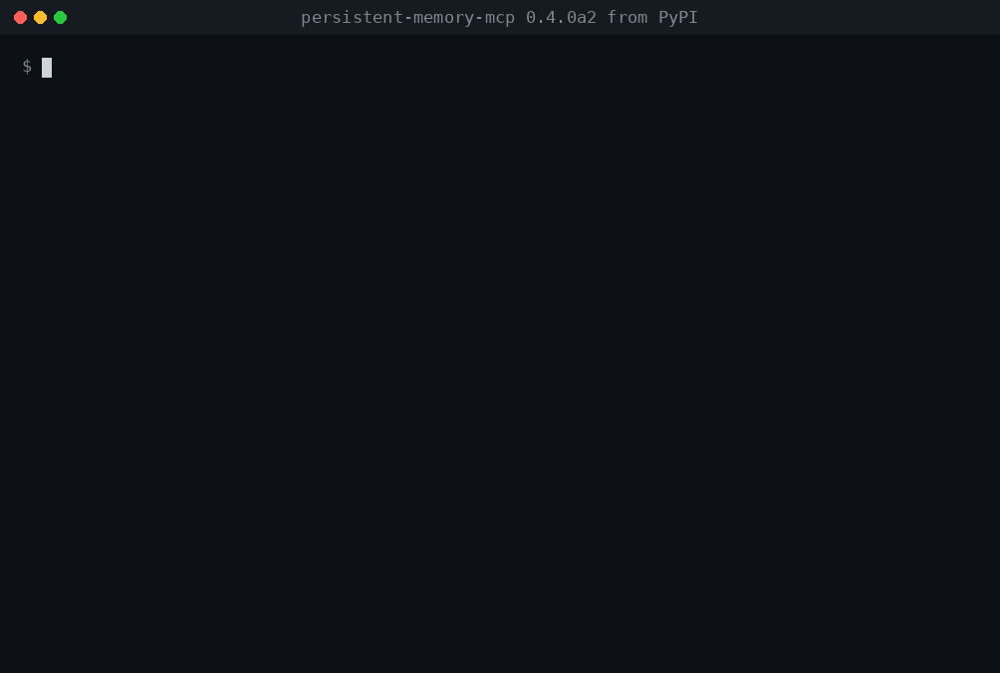

# Terminal demo

[README](https://github.com/Musyg/persistent-memory/blob/main/README.md)



Recorded on 16 November 2026 on Linux with Python 3.13, in a new virtual environment, with persistent-memory-mcp 0.4.0a2 installed from PyPI. Everything on screen is the real output of pip, the `persistent-memory` command and the Python interpreter. Only the typing is scripted, so that the session can be recorded again the same way.

What it shows:

1. A fact is remembered as a source: the staging database listens on port 6543.
2. A note is derived from that exact version: open port 6543 on the staging firewall. Search returns both.
3. The source is corrected to port 6544 by compare-and-swap. The note built on 6543 is now `superseded` and search no longer returns it.
4. The source is withdrawn. Search returns nothing, and `explain` gives the reason, `source_revoked`.

Files:

| File | Content |
| --- | --- |
| `persistent-memory-demo.gif` | The rendered recording, about one minute |
| `persistent-memory-demo.cast` | The raw recording, asciinema v2 format |
| `record.py` | Types the commands into bash and Python; run it under `asciinema rec` |
| `render.py` | Turns the recording into frames for ffmpeg; long waits are shortened and typing is sped up |

To record it again (needs `asciinema`, `pexpect`, `pyte`, Pillow and ffmpeg):

```sh
python3 -m venv demo-venv && mkdir demo-work
asciinema rec --cols 96 --rows 26 -c "python3 record.py $PWD/demo-venv $PWD/demo-work" demo.cast
python3 render.py demo.cast frames "'source_revoked'"
ffmpeg -f concat -safe 0 -i frames/list.txt -vf "fps=12,split[a][b];[a]palettegen=max_colors=48:stats_mode=full[p];[b][p]paletteuse=dither=none:diff_mode=rectangle" demo.gif
```

`render.py` expects the DejaVu Sans Mono font at its usual Linux path.

---

# Démo en terminal

Enregistrée le 16 novembre 2026 sous Linux avec Python 3.13, dans un environnement virtuel neuf, avec persistent-memory-mcp 0.4.0a2 installé depuis PyPI. Tout ce qui s'affiche est la vraie sortie de pip, de la commande `persistent-memory` et de l'interpréteur Python. Seule la frappe est scriptée, pour pouvoir refaire l'enregistrement à l'identique.

Ce qu'elle montre :

1. Un fait est enregistré comme source : la base de staging écoute sur le port 6543.
2. Une note est dérivée de cette version exacte : ouvrir le port 6543 sur le pare-feu de staging. La recherche renvoie les deux.
3. La source est corrigée en port 6544, par compare-and-swap. La note bâtie sur 6543 passe à l'état `superseded` et la recherche ne la renvoie plus.
4. La source est retirée. La recherche ne renvoie plus rien, et `explain` donne la raison, `source_revoked`.

Les fichiers et la façon de refaire l'enregistrement sont décrits ci-dessus.
